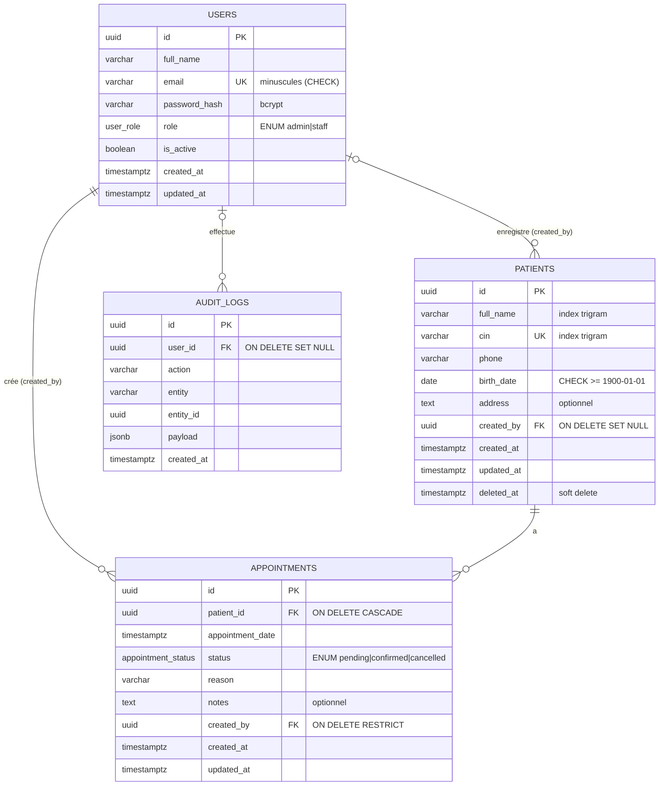

# ClinicFlow — Conception de la base de données

Le schéma a été conçu avant le code. Il est implémenté dans
[`backend/src/db/migrations/001_init.sql`](../backend/src/db/migrations/001_init.sql).

## 1. Diagramme entité-relation (ERD)



## 2. Relations et justification

| Relation | Cardinalité | Justification |
|---|---|---|
| `patients` → `appointments` | **1-N** | Un patient a 0..N rendez-vous ; un rendez-vous concerne exactement un patient (`patient_id NOT NULL`). |
| `users` → `appointments` (`created_by`) | **1-N** | Chaque rendez-vous est créé par un utilisateur (traçabilité exigée : `createdBy`). |
| `users` → `patients` (`created_by`) | **1-N** (optionnelle) | Savoir qui a ouvert le dossier ; nullable pour ne pas bloquer la suppression d’un compte. |
| `users` → `audit_logs` | **1-N** (optionnelle) | Journal des actions sensibles (création, modification, suppression, changement de statut). |

**Pas de relation N-N** : un rendez-vous relie un seul patient à un seul créateur ; il n’y a pas
(encore) de notion de praticien multiple par rendez-vous. Si la clinique ajoutait plusieurs
médecins, `appointments` porterait un `doctor_id` (1-N), et une table de liaison
`doctor_specialties` (N-N) apparaîtrait. **Pas de 1-1** non plus : aucune donnée n’a besoin d’être
isolée dans une table satellite (le profil utilisateur tient dans `users`).

## 3. Règles de suppression (FK) — choix et raisons

| FK | Règle | Pourquoi |
|---|---|---|
| `appointments.patient_id` | `ON DELETE CASCADE` | Un rendez-vous n’a pas de sens sans patient. En pratique l’API fait un **soft delete** (`deleted_at`), donc le CASCADE ne joue que pour une purge physique volontaire (RGPD / loi 09-08). |
| `appointments.created_by` | `ON DELETE RESTRICT` | On ne doit pas perdre la traçabilité « qui a créé ce rendez-vous ». Un compte est **désactivé** (`is_active = false`), jamais supprimé. |
| `patients.created_by` | `ON DELETE SET NULL` | Information secondaire : le dossier patient doit survivre au compte. |
| `audit_logs.user_id` | `ON DELETE SET NULL` | Le journal est conservé même si l’auteur disparaît. |

## 4. Contraintes

- **UUID PK** partout (`gen_random_uuid()` via `pgcrypto`) : identifiants non devinables dans les URLs.
- **`patients.cin UNIQUE`** — l’unicité inclut les patients archivés : un CIN identifie une personne
  et ne doit jamais être réattribué. L’API renvoie `409` avec un message précis.
- **ENUM Postgres** `user_role` et `appointment_status` (bonus) : valeurs invalides impossibles.
- **CHECK** : email en minuscules, nom non vide, date de naissance ≥ 1900.
- **Règle métier en base** — contrainte d’exclusion GiST :
  ```sql
  EXCLUDE USING gist (patient_id WITH =, appointment_slot(appointment_date) WITH &&)
  WHERE (status = 'confirmed')
  ```
  Chaque RDV confirmé occupe `[date, date + 30 min)` ; deux plages se chevauchent exactement quand
  les RDV sont à moins de 30 minutes. La base refuse donc *deux RDV confirmés d’un même patient
  dans une fenêtre de 30 minutes*, **même en cas de requêtes concurrentes**. Le service vérifie
  la règle avant (message clair + verrou `FOR UPDATE` sur le patient), la contrainte est la
  garantie finale. Les RDV `pending` / `cancelled` ne sont pas concernés.
- **`updated_at`** maintenu par trigger.

## 5. Index (performance)

| Index | Sert à |
|---|---|
| `patients_full_name_trgm_idx` (GIN trigram) | Recherche `ILIKE '%terme%'` sur le nom (un B-tree ne sert pas les `%…%`). |
| `patients_cin_trgm_idx` (GIN trigram) | Recherche partielle sur le CIN. |
| `patients_cin_key` (unique B-tree) | Unicité + recherche exacte CIN. |
| `patients_active_created_idx` (partiel `WHERE deleted_at IS NULL`) | Liste paginée par défaut (plus récents d’abord). |
| `appointments_date_idx` | Filtre `?date=` et « rendez-vous du jour » (bornes en `timestamptz`). |
| `appointments_patient_date_idx` | Historique d’un patient + vérification du conflit 30 min. |
| `appointments_status_date_idx` | Filtre `?status=` et compteurs du dashboard. |
| `appointments_created_by_idx` | FK (évite un scan lors de vérifications RESTRICT). |
| GiST de la contrainte d’exclusion | Détection de chevauchement. |

Pagination : `LIMIT/OFFSET` + `count(*)` séparé, `limit` plafonné à 100 par la validation.

## 6. Bonus implémentés

- `deleted_at` (soft delete) — la suppression admin archive le patient et annule ses RDV à venir.
- Table `audit_logs` alimentée dans la même transaction que la modification.
- ENUM Postgres + CHECK constraints.
- Fuseau horaire : les dates sont stockées en `timestamptz` (UTC) ; « aujourd’hui » et le filtre
  `?date=` sont calculés dans le fuseau de la clinique (`APP_TIMEZONE`, défaut `Africa/Casablanca`).
